# Implemented data model

Generated from SQLAlchemy metadata; migrations 0001–0002 are checked against PostgreSQL. Nullable grade/response/evidence timestamps are detailed in the data dictionary. FK deletion rules appear on relationship labels.

```mermaid
erDiagram
    LESSONS ||--o{ ACTIVITIES : "lesson_id; RESTRICT"
    ACTIVITIES ||--o{ ACTIVITY_SKILLS : "activity_id; CASCADE"
    SKILLS ||--o{ ACTIVITY_SKILLS : "skill_id; RESTRICT"
    CHILD_PROFILES ||--o{ ATTEMPTS : "child_id; RESTRICT"
    ACTIVITIES ||--o{ ATTEMPTS : "activity_id; RESTRICT"
    USERS ||--o{ AUTH_SESSIONS : "user_id; CASCADE"
    USERS ||--o{ CHILD_PROFILES : "user_id; RESTRICT"
    USERS ||--o{ CLASSES : "teacher_id; RESTRICT"
    CLASSES ||--o{ ENROLLMENTS : "class_id; CASCADE"
    CHILD_PROFILES ||--o{ ENROLLMENTS : "child_id; RESTRICT"
    USERS ||--o{ GUARDIAN_CHILDREN : "guardian_id; RESTRICT"
    CHILD_PROFILES ||--o{ GUARDIAN_CHILDREN : "child_id; RESTRICT"
    CHILD_PROFILES ||--o{ RECOMMENDATIONS : "child_id; RESTRICT"
    ACTIVITIES ||--o{ RECOMMENDATIONS : "activity_id; RESTRICT"
    ATTEMPTS ||--o{ RECOMMENDATIONS : "triggering_attempt_id; SET NULL"
    CHILD_PROFILES ||--o{ SKILL_MASTERY : "child_id; RESTRICT"
    SKILLS ||--o{ SKILL_MASTERY : "skill_id; RESTRICT"
    ACTIVITIES {
        uuid id PK
        uuid lesson_id FK
        varchar title
        activity_type activity_type
        text prompt
        jsonb content
        smallint difficulty
        integer sequence
        content_status status
    }
    ACTIVITY_SKILLS {
        uuid activity_id PK,FK
        uuid skill_id PK,FK
        numeric weight
    }
    ATTEMPTS {
        uuid id PK
        uuid child_id FK
        uuid activity_id FK
        boolean is_correct
        integer response_ms
        jsonb answer
        datetime occurred_at
        datetime created_at
    }
    AUTH_SESSIONS {
        varchar token_hash PK
        uuid user_id FK
        datetime expires_at
    }
    CHILD_PROFILES {
        uuid id PK
        uuid user_id FK,UK
        varchar display_name
        smallint grade_level
        smallint current_level
        datetime created_at
    }
    CLASSES {
        uuid id PK
        uuid teacher_id FK
        varchar name
        varchar join_code UK
        class_status status
        datetime created_at
    }
    ENROLLMENTS {
        uuid class_id PK,FK
        uuid child_id PK,FK
        datetime enrolled_at
        enrollment_status status
    }
    GUARDIAN_CHILDREN {
        uuid guardian_id PK,FK
        uuid child_id PK,FK
        varchar relationship_label
        datetime created_at
    }
    LESSONS {
        uuid id PK
        varchar title
        text description
        integer sequence
        content_status status
        datetime updated_at
        datetime created_at
    }
    LOGIN_THROTTLES {
        varchar email PK
        integer failures
        datetime window_start
    }
    RECOMMENDATIONS {
        uuid id PK
        uuid child_id FK
        uuid activity_id FK
        uuid triggering_attempt_id FK
        numeric priority_score
        varchar reason_code
        jsonb reason_details
        varchar algorithm_version
        recommendation_status status
        datetime created_at
    }
    SKILL_MASTERY {
        uuid child_id PK,FK
        uuid skill_id PK,FK
        numeric score
        mastery_band band
        mastery_confidence confidence
        integer attempt_count
        datetime last_practiced_at
        varchar algorithm_version
        integer version
        datetime updated_at
    }
    SKILLS {
        uuid id PK
        varchar code UK
        varchar name
        varchar category
        smallint level
        content_status status
    }
    USERS {
        uuid id PK
        citext email UK
        varchar password_hash
        user_role role
        user_status status
        datetime updated_at
        datetime created_at
    }
```

