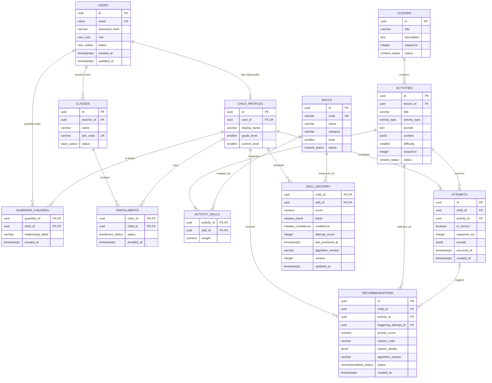

# ReadQuest logical ERD — v1

GitHub renders this Mermaid diagram directly. The detailed field rules are in `DATA_DICTIONARY.md`.

## Main adaptive path

`child_profiles → attempts → activity_skills → skills → skill_mastery → recommendations → activities`

This path is the central technical contribution: a completed activity becomes durable evidence, updates per-skill mastery, and produces an explainable next activity.

