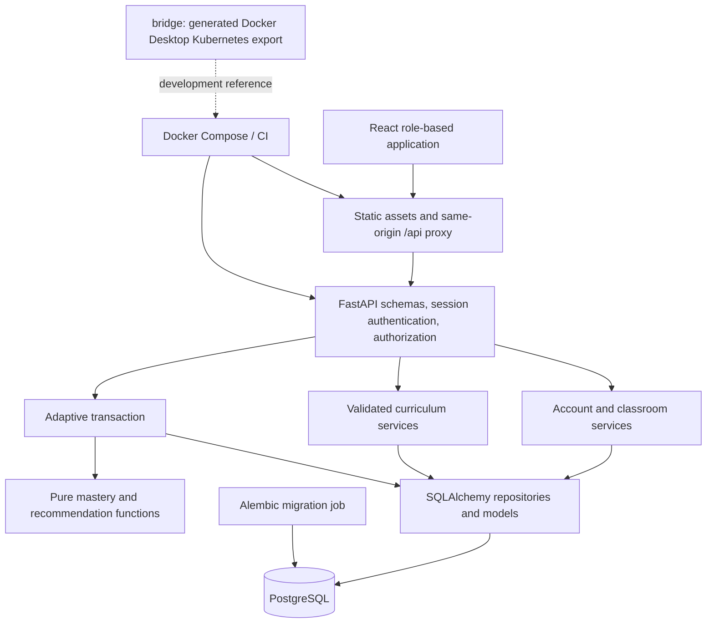

# Production architecture and decisions

## Components

The browser displays server scores; it never supplies correctness or learner identity to production submissions. HTTP routes own transactions; repositories own SQL; adaptive pure functions own math. Models and API schemas remain separate. All role restrictions are supplemented by relationship checks: a parent can read only guardian-linked children; a teacher only active enrollments in their active classes; a child only their own profile; an admin can administer all records. Teachers cannot attach arbitrary children: guardians enroll through class join codes.

## Authentication

Argon2id hashes passwords. A 256-bit opaque random session token is stored only in an HttpOnly SameSite=Lax cookie; PostgreSQL stores its SHA-256 digest and expiry. Sessions expire after eight hours by default, are revoked at logout, password change or deactivation, and never contain trusted role claims. Authorization loads the current active user each request. Mutating requests with a browser Origin must match configured origins; production cookies require HTTPS. Login failures are throttled per normalized account using database state and an advisory lock; no credentials appear in errors or logs. Public registration is intentionally absent: parents/admins provision child accounts, admins provision adult accounts. Initial admin is provisioned by an explicit CLI reading a password interactively or securely from runtime environment; no fixed production password.

## Demo compatibility

Development keeps /demo/activities and /demo/attempts for the existing sample contract. Production registers neither route. React defaults to authenticated /api routes; development demo mode is explicit. Demo seeds retain unusable hashes unless an explicit local demo-password runtime value is supplied. The opt-in demo seed is prohibited in production. No automatic anonymous fallback on auth failure.

## Adaptive decisions

Retain mastery-v1: last ten attempts, 60% accuracy + 20% last-three accuracy + 20% accuracy-scaled consistency. Bands: <0.60 high priority; <0.75 additional practice; <0.90 normal review; otherwise mastered. Confidence depends on window sample count, not lifetime count. Response time is stored but excluded. Attempts are immutable and timestamped by the server.

Retain recommendation-v1: 55% mastery gap + 25% review due + 15% difficulty fit + 5% variety. Review due = 1 - exp(-days/7); no practice implies due=1. Difficulty fit is 1/0.75/0.35/0 at distance 0/1/2/>2. Four-hour repetition cooldown. Only published activity+lesson+skills are eligible. Ties use activity then skill UUID; activities appear once using their strongest skill candidate. Explainable codes: PRACTICE_WEAK_SKILL, SPACED_REVIEW_DUE, MATCHED_DIFFICULTY, VARIETY_ROTATION. Keep weights unchanged to preserve validated demo semantics. Multi-skill mapping weights total one; mastery records remain per-skill evidence rather than fractional correctness.

## Scope and privacy

One role per account; children may join multiple classes. Use display names rather than legal names. Retain course-demo evidence; a real deployment requires a retention/consent policy and provider credentials. No speech recognition, generative AI, offline sync, or marketplace scope. Curriculum remains choice-based for all three stored activity types; passage-based read-and-answer uses a passage plus choices. Word-match uses a prompt plus choice options. Content and keys cannot be edited after attempts exist; archive and create a new activity instead.

## bridge purpose

bridge/base and bridge/overlays/desktop were generated from Compose for Docker Desktop Kubernetes. They contain development credentials, local image names, a hostpath PVC and no frontend; they are not the production deployment path. The migration Deployment restarts a one-time command, probes were generated incorrectly, and the database is publicly exposed by the desktop overlay. Treat this folder as an archived development reference; production uses managed PostgreSQL and the reviewed Compose override/provider process. See bridge/README.md for explicit limitations.

These scores summarize recent demonstration evidence; they are not a validated reading assessment. Automated checks establish the implemented behavior, not an educational outcome.
