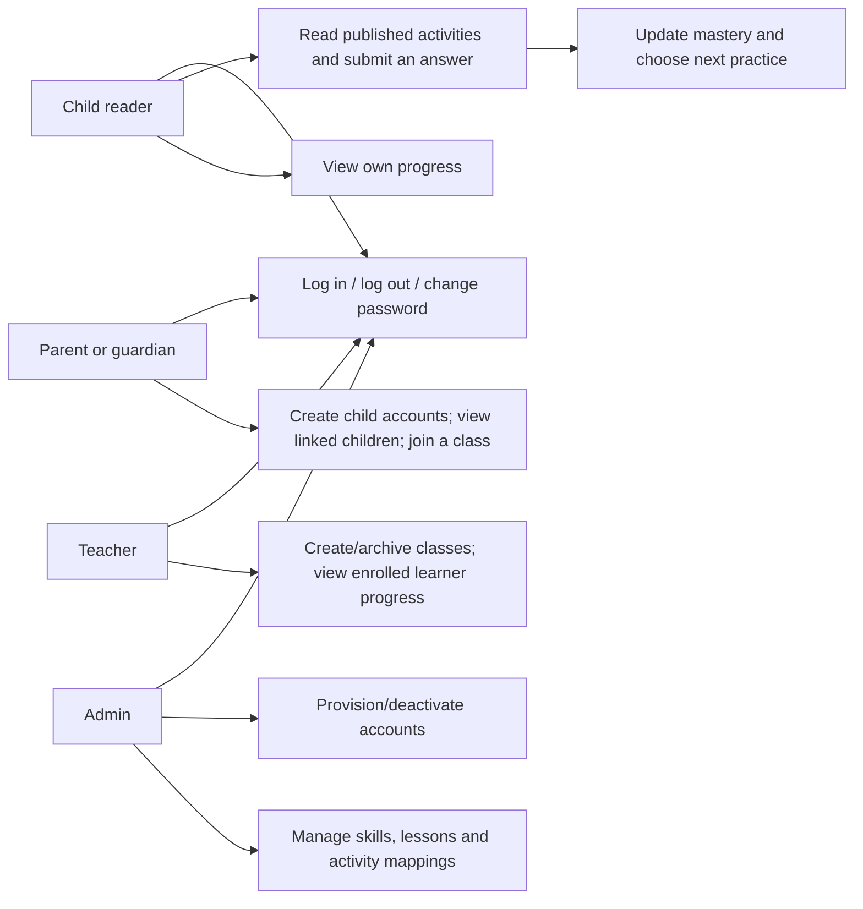
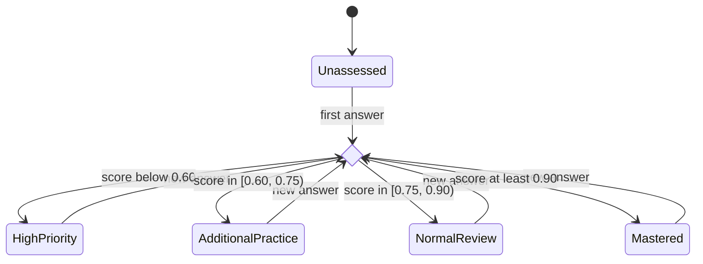

# System models

## Actors and use cases



## Login

```mermaid
sequenceDiagram
  actor User
  participant UI as React
  participant API as Auth API
  participant DB as PostgreSQL
  User->>UI: Email and password
  UI->>API: POST /auth/login
  API->>DB: Load active user; serialize login throttling
  API->>API: Verify Argon2id hash
  alt valid credentials
    API->>DB: Store SHA-256 digest of random session token, expiry
    API-->>UI: HttpOnly session cookie; safe user profile
  else invalid or throttled
    API-->>UI: Generic 401 or 429
  end
```

## Start and submit activity

```mermaid
sequenceDiagram
  actor Child
  participant UI as React
  participant API as Production API
  participant Service as Adaptive workflow
  participant DB as PostgreSQL
  Child->>UI: Choose an activity
  UI->>API: GET /activities/{id} with session cookie
  API->>DB: Require published lesson, activity and skills
  API-->>UI: Prompt and choices, without answer key
  Child->>UI: Select answer
  UI->>API: POST /attempts with activity_id and selected_index
  API->>DB: Validate session; derive child and learner level
  API->>API: Score answer using stored correct_index
  API->>Service: Submit server-authored command
  Service->>DB: Lock child and sorted skills; insert attempt
  Service->>DB: Read evidence; upsert mastery; rank eligible activities
  Service->>DB: Persist recommendation; commit one transaction
  API-->>UI: Correctness, mastery and explained recommendation
  Note over API,DB: Any error rolls back the entire transaction
```

## Mastery progression

Bands are recalculated from the last ten attempts and may move in either direction. Cold-start evidence is not failure. Confidence is independent: low for 0–2, medium for 3–6, high for 7–10 samples.


